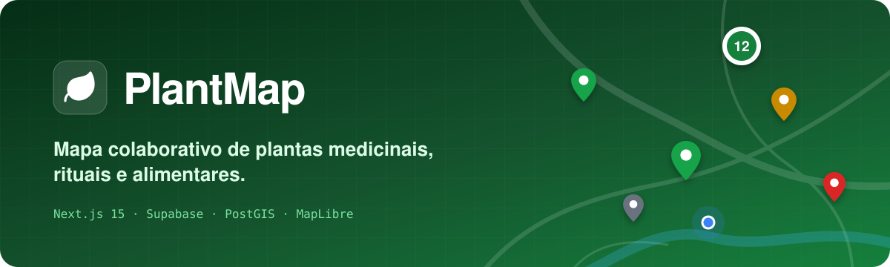
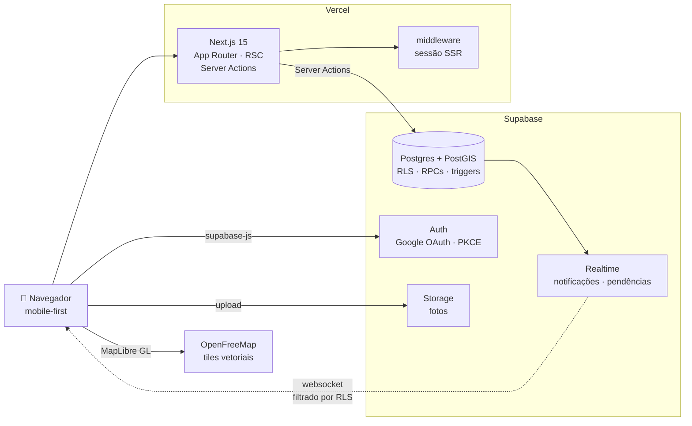

<div align="center">



<br />

[](https://github.com/leonfpontes/PlantMap/actions/workflows/ci.yml)


**[Abrir o app](https://plantastiamaria.vercel.app)** · [Guia de onboarding](ONBOARDING.md) · [Migrations](supabase/migrations)

</div>

---

O **PlantMap** é um mapa colaborativo para encontrar e cuidar de plantas medicinais, rituais e
alimentares. Quem anda pela cidade marca onde está aquela arruda, aquele guiné ou aquela espada-de-são-jorge,
fotografa, registra a condição e volta depois para contar como ela está. Com o tempo, o mapa vira
um retrato vivo de onde cada erva pode ser encontrada — e de quem ajuda a mantê-lo de pé.

É uma aplicação **mobile-first** feita para ser usada no meio da rua, com o celular numa mão:
GPS que acompanha quem anda, mapa que escurece sozinho à noite, foto direto da câmera e um
ranking que premia não só quem cadastra, mas quem volta para cuidar.

> [!NOTE]
> O projeto está em **fase fechada de testes**, com um grupo pequeno de usuários dando feedback.
> O login é aberto, mas registrar plantas no mapa exige liberação de um admin.

## Sumário

- [Destaques](#destaques)
- [Arquitetura](#arquitetura)
- [Decisões de engenharia](#decisões-de-engenharia)
- [Stack](#stack)
- [Começando](#começando)
- [Estrutura do projeto](#estrutura-do-projeto)
- [Permissões e moderação](#permissões-e-moderação)
- [Ranking](#ranking)
- [Qualidade e CI](#qualidade-e-ci)
- [Deploy](#deploy)

## Destaques

| | |
|---|---|
| 🗺️ **Mapa vivo** | Pins coloridos pela condição da planta, com a foto da espécie no marcador. Afastando o zoom, os pins se agrupam em bolhas com contagem. |
| 🌙 **Tema que acompanha o dia** | O mapa base ganha a paleta do app, segue o tema claro/escuro e escurece sozinho das 18h às 6h — sem polling. |
| 📍 **GPS em movimento** | O ponto azul acompanha quem anda, e o registro pode usar a posição atual em um toque. |
| 🔎 **Busca que perdoa** | `guine` acha *Guiné*; hífen, barra e ordem das palavras não atrapalham. Feita no Postgres, não no cliente. |
| 🌿 **Catálogo moderado** | Qualquer pessoa sugere uma erva nova; ela só aparece para todos depois que um admin aprova. |
| 🏆 **Ranking com propósito** | Pontos por cadastrar e por manter, nove tiers com moldura de avatar própria e um livro-razão que nunca deixa saldo inconsistente. |
| 🔔 **Notificações e realtime** | Aprovações, rejeições e edições de terceiros viram notificação; contadores do painel admin sobem sozinhos via Supabase Realtime. |
| 🛡️ **Privacidade de verdade** | Localização aproximada (~500 m) por padrão, opt-in para ponto exato, exportação dos próprios dados e exclusão de conta. |
| 🧾 **Nada se perde** | Soft delete e log de auditoria automático em todas as alterações de ocorrências e espécies. |
| 🧑‍💼 **Back-office completo** | Painel admin com filas de espécies, pedidos de permissão, usuários e caixa de suporte. |

## Arquitetura



O Next.js cuida da renderização e das mutações via **Server Actions**; o banco é a fonte da verdade
para **regra de negócio e autorização**. Toda escrita sensível passa por RPCs `security definer`
com `search_path` fixo, e as tabelas são protegidas por **Row Level Security** — então nem um
cliente com a anon key consegue furar o fluxo.

## Decisões de engenharia

Algumas escolhas que valem a leitura do código:

<details>
<summary><b>Regras no banco, não no cliente</b></summary>

<br />

Aprovar uma espécie, pedir permissão para registrar ou revisar esse pedido nunca é um
`insert`/`update` direto: passa por RPCs (`submit_species`, `review_species`,
`request_occurrence_permission`, `review_occurrence_permission_request`). A flag `is_admin` nem
sequer é exposta pela API. As funções `security definer` têm `EXECUTE` revogado de quem não deve
chamá-las e `search_path` fixado
([migration 031](supabase/migrations/031_function_grants_and_search_path.sql)).

</details>

<details>
<summary><b>Pontos como livro-razão</b></summary>

<br />

Quem concede pontos é uma trigger em `log_occurrence_change()`, não o app. Cada movimentação vira
uma linha em `points_log`, e `profiles.points` é sempre exatamente a soma do log. Excluir uma
ocorrência lança um estorno do que ela rendeu — nunca deixando o saldo negativo — e restaurá-la
devolve só o que falta
([migration 029](supabase/migrations/029_ranking_rebalance_and_delete_revoke.sql)).

</details>

<details>
<summary><b>Privacidade por grade</b></summary>

<br />

Para quem não optou por compartilhar o ponto exato, `search_nearby` devolve a coordenada
encaixada numa grade de ~0,0045° (≈ 500 m). O próprio dono e os admins continuam vendo o ponto
real. A aproximação acontece no SQL, então a coordenada exata nunca chega ao navegador de
terceiros ([migration 019](supabase/migrations/019_privacy.sql)).

</details>

<details>
<summary><b>Clusterização em espaço de tela</b></summary>

<br />

Agrupar por graus juntaria demais numa ponta do zoom e de menos na outra. Os pins são projetados
em Web Mercator para os pixels do zoom atual e agrupados numa grade simples, com o marcador no
centroide do grupo — uma função pura, testável e sem dependência nova
([`src/lib/cluster.ts`](src/lib/cluster.ts)).

</details>

<details>
<summary><b>Mapa recolorido por contrato, não por id</b></summary>

<br />

Em vez de manter uma cópia do estilo Liberty, a paleta do PlantMap é aplicada por cima das
camadas classificadas pelo `source-layer` do esquema OpenMapTiles — que é contrato, enquanto ids
de camada mudam entre versões. Uma atualização do estilo degrada para "parte do mapa não
recolorida", nunca para mapa quebrado ([`src/lib/mapTheme.ts`](src/lib/mapTheme.ts)).

</details>

<details>
<summary><b>Mapa noturno com um único timer</b></summary>

<br />

`useIsNight` calcula quanto falta para a próxima virada (18h ou 6h, no relógio do aparelho) e
agenda um só `setTimeout`, em vez de conferir a hora de minuto em minuto. Começa em `false` para
não divergir da marcação do servidor e quebrar a hidratação
([`src/hooks/useIsNight.ts`](src/hooks/useIsNight.ts)).

</details>

<details>
<summary><b>Realtime que respeita RLS</b></summary>

<br />

As filas de pendência do admin são publicadas no Supabase Realtime, que avalia a policy de
`select` por assinante — o evento só chega a quem já podia ler a linha por HTTP. Como a policy não
depende de colunas da linha, a identidade de réplica padrão basta, sem engordar o WAL com
`REPLICA IDENTITY FULL`
([migration 030](supabase/migrations/030_realtime_admin_pendencias.sql)).

</details>

<details>
<summary><b>Busca sem acento e sem atrito</b></summary>

<br />

A busca de espécies normaliza acentos e separadores no Postgres e casa por tokens, então a ordem
das palavras não importa
([migrations 025](supabase/migrations/025_accent_insensitive_search.sql) e
[027](supabase/migrations/027_search_separators_and_tokens.sql)). No cliente, um hook com
debounce evita uma consulta por tecla.

</details>

## Stack

| Camada | Tecnologia |
|---|---|
| Framework | [Next.js 15](https://nextjs.org) (App Router, Server Actions, Turbopack) + React 19 |
| Linguagem | TypeScript |
| Banco de dados | [Supabase](https://supabase.com) — PostgreSQL + PostGIS, RLS, RPCs e triggers |
| Autenticação | Supabase Auth — Google OAuth com PKCE, sessão SSR via `@supabase/ssr` |
| Storage e realtime | Supabase Storage (fotos) e Supabase Realtime |
| Mapa | [MapLibre GL](https://maplibre.org) + `react-map-gl`, tiles da [OpenFreeMap](https://openfreemap.org) |
| Estilo | Tailwind CSS v4, ícones [Lucide](https://lucide.dev) |
| Formulários | react-hook-form + Zod v4 |
| Testes | Vitest + Testing Library (jsdom) |
| Infra local | Docker Compose espelhando o ecossistema Supabase (Kong, GoTrue, PostgREST, Storage) |
| Deploy | Vercel + Supabase Cloud, CI no GitHub Actions |

## Começando

### Pré-requisitos

- Node.js 22+
- Docker (para o stack Supabase local) **ou** um projeto no Supabase Cloud

### Rodando

```bash
git clone https://github.com/leonfpontes/PlantMap.git
```

```bash
cd PlantMap && npm install
```

```bash
cp .env.example .env.local
```

Preencha o `.env.local` (veja [`.env.example`](.env.example), que documenta cada variável):

```env
NEXT_PUBLIC_SUPABASE_URL=http://localhost:8000
NEXT_PUBLIC_SUPABASE_ANON_KEY=
NEXT_PUBLIC_APP_URL=http://localhost:3000
```

Suba o stack local — banco, auth, REST, storage e gateway — e rode as migrations
automaticamente:

```bash
docker compose up -d
```

E o app:

```bash
npm run dev
```

Pronto: [http://localhost:3000](http://localhost:3000).

> [!TIP]
> O [**Guia de Onboarding**](ONBOARDING.md) detalha cada container do `docker-compose.yml`, a
> diferença entre rede Docker e host, a ordem de coordenadas do PostGIS, como criar usuários de
> teste e como promover alguém a admin.

### Scripts

| Comando | O que faz |
|---|---|
| `npm run dev` | Servidor de desenvolvimento com Turbopack |
| `npm run build` | Build de produção |
| `npm start` | Serve o build de produção |
| `npm run lint` | ESLint |
| `npm test` | Vitest, uma passada |
| `npm run test:watch` | Vitest em modo watch |

## Estrutura do projeto

```
src/
├── app/                  # Rotas (App Router)
│   ├── map/              #   mapa principal
│   ├── search/           #   busca por espécie
│   ├── plant/            #   detalhe, registro e edição de ocorrência
│   ├── profile/          #   perfil, favoritos, ranking, privacidade, aparência…
│   ├── admin/            #   back-office: espécies, usuários, suporte
│   └── auth/             #   login e callback OAuth
├── components/
│   ├── map/              # PlantMap, PlantPin, ClusterBubble, balões
│   ├── plant/            # formulários, cards, combobox de espécie, lightbox
│   ├── profile/          # ranking, privacidade, notificações, FAQ
│   ├── admin/            # filas de moderação, realtime, inbox de suporte
│   ├── layout/           # AppShell, Sidebar, BottomNav
│   └── ui/               # Button, Input, Badge, BottomSheet, Avatar…
├── hooks/                # useGeolocation, useIsNight, useSpeciesSearch, usePhotoUpload…
├── lib/
│   ├── actions/          # Server Actions por domínio
│   ├── supabase/         # clients SSR e browser
│   ├── cluster.ts        # agrupamento de pins
│   ├── mapTheme.ts       # paleta do mapa e faixa noturna
│   └── geo.ts            # distâncias e geolocalização
├── constants/            # condição, estágio, tiers do ranking, FAQ, política
├── types/                # tipos globais
├── test/                 # suíte Vitest
└── middleware.ts         # refresh de sessão Supabase
supabase/
├── migrations/           # 31 migrations SQL, numeradas e comentadas
└── docker/               # configuração do Kong
```

## Permissões e moderação

| Ação | Quem pode |
|---|---|
| Ver o mapa e buscar | Qualquer pessoa |
| Entrar | Qualquer conta Google |
| Favoritar e sugerir uma erva | Usuário autenticado |
| Registrar ocorrência | Usuário com `can_register_occurrences`, concedida por um admin |
| Editar ou excluir ocorrência | O próprio dono ou um admin |
| Aprovar espécies e pedidos | Admin (`is_admin`, alterável só direto no banco) |

**Registro de ocorrências.** Contas novas nascem sem permissão de registrar. O pedido é feito em
`/profile/permission` e revisado em `/admin/users`, onde o admin também pode conceder ou revogar
diretamente ([migration 021](supabase/migrations/021_registration_permission.sql)).

**Catálogo de espécies.** Uma erva sugerida nasce com `status = 'pending'` e só fica visível para
quem sugeriu até ser aprovada. Rejeições exigem motivo, e todo o fluxo é auditado em
`species_audit_log` ([migration 013](supabase/migrations/013_species_moderation.sql)).

- Sugerir: botão **"Sugerir nova erva"** na busca de espécie do formulário.
- Acompanhar as próprias sugestões: `/profile/species`.
- Moderar: `/admin/species`.

## Ranking

Cadastrar uma planta rende **+10**; voltar para atualizar a condição dela rende **+5**, uma vez a
cada 30 dias por ocorrência — repetível para sempre. A escada começa com degraus curtos, para dar
retorno rápido a quem chega, e a partir de 1.200 pontos dobra a cada nível, para premiar quem fica.

| Tier | Pontos |
|---|---:|
| Sementeira | 0 |
| Broto | 25 |
| Raiz | 100 |
| Guardião do Mato | 250 |
| Ancestral Verde | 600 |
| Tronco Firme | 1.200 |
| Copa Sagrada | 2.500 |
| Mata Viva | 5.000 |
| Encantado da Mata | 10.000 |

Cada tier tem sua moldura de avatar. As regras completas ficam em `/profile/ranking`, e a
configuração de exibição em [`src/constants/ranking.ts`](src/constants/ranking.ts).

## Qualidade e CI

```bash
npm run lint && npm test
```

São **220 testes** em 23 arquivos, cobrindo Server Actions, fluxos de aprovação do admin,
componentes de formulário e moderação, o algoritmo de cluster, a paleta e a faixa noturna do mapa,
geolocalização e busca. O workflow [`ci.yml`](.github/workflows/ci.yml) roda lint, testes e build
em todo push e pull request para `master`.

## Deploy

| Peça | Onde |
|---|---|
| App | Vercel — cada push na `master` vira deploy de produção |
| Banco, auth, storage e realtime | Supabase Cloud |
| Tiles do mapa | OpenFreeMap |

Migrations novas entram numeradas em [`supabase/migrations/`](supabase/migrations) e são aplicadas
no projeto Supabase antes do push que depende delas.

---

<div align="center">
<sub>Feito com 🌿 para quem sabe que cada erva tem seu lugar.</sub>
</div>
